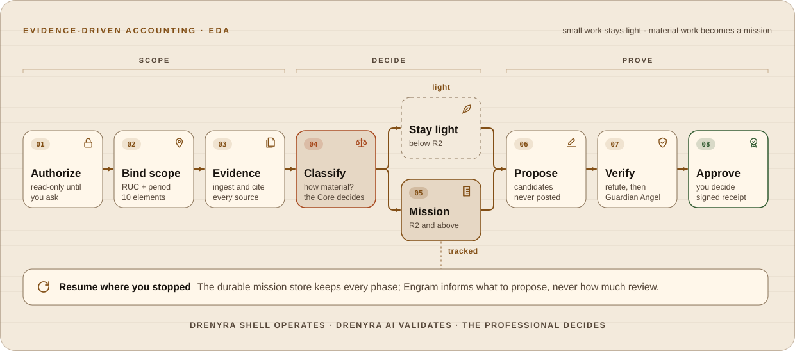
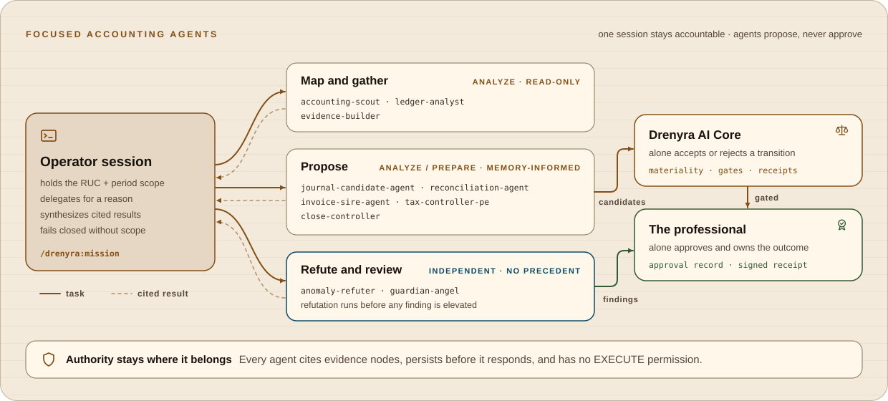

<a id="top"></a>

<div align="center">
  
</div>

<h1 align="center">Drenyra Shell</h1>

<p align="center"><strong>The accounting operations harness for Drenyra AI.<br>It operates. It never authorizes.</strong></p>

<p align="center">
  
  
  
  
</p>

<p align="center">
  <strong>
    <a href="#status">Status</a>
    &nbsp;·&nbsp;
    <a href="#how-it-works">How it works</a>
    &nbsp;·&nbsp;
    <a href="#get-started">Get started</a>
    &nbsp;·&nbsp;
    <a href="#known-limitations">Known limitations</a>
    &nbsp;·&nbsp;
    <a href="#documentation">Docs</a>
  </strong>
</p>

<br>

<p align="center">Your agent can propose a journal entry. It must not be able to post one.<br><strong>Drenyra Shell packages the operator experience for Peruvian accounting work on top of a pinned, verified Drenyra AI runtime — and keeps the decision with the professional.</strong></p>

---

<a id="status"></a>

## ⚠️ Status — pre-release, and honest about it

**`v0.1.0`, contracts frozen, not production-ready.** The harness extraction from
`arkelythex/drenyra-console` (`packages/pi`) is complete: this repository is
now the single source of truth for the Shell accounting harness. Two produced
contracts are frozen at v0.1, which is the `0.1.0` step of the version policy.

**No capability in this repository is `validated-end-to-end`.** There is no live
operational run of an installed Pi command against external services. Packaged
skills and the Engram boundary are local or referenced-only evidence — never
operational integration.

| Works today | Does not exist yet |
| --- | --- |
| 21 `/drenyra:*` commands, all registered | Publication on npm |
| Pinned `drenyra-ai@0.8.0` with checksum verification that fails closed | Typed fiscal tools beyond the proposal half (`ingest_cpe`, `close_period`) |
| Signed, verifiable receipts through `ReceiptStore` | A measured eval set against a professional's own work |
| Checksum-pinned Drenyra Engram reads — `engram_search` and `engram_context` over the vendored, attested `v0.9.0` release, reachable by the four proposing agents | — |
| A `books` operation mode where `/drenyra:mode books` denies `bash`, `write`, `edit` and every unlisted tool by default | — |
| Fiscal scope (RUC + period) threading and fail-closed guards | — |
| RDA command chains, persona, startup panel, 11 packaged skills | — |
| `propose_journal_entry` — the kernel validates the scope, accepts the evidence and records a balanced entry (it is recorded, never posted) | — |

Everything below is written against that table. If a claim is not backed by a
`file:line` you can open, it does not belong in this README.

<!-- conformance:surface id=readme authority=pi-operates-never-authorizes source=AGENTS.md#non-negotiable-rules -->
<!-- conformance:snapshot scope=current source=capability-manifest.yaml#/evidenceSnapshot -->

[`capability-manifest.yaml`](capability-manifest.yaml) is the machine-readable
capability record; the
[conformance matrix](docs/architecture/capability-conformance-matrix.md) is its
human-readable explanation, evidence citations, limitations, and the exact rules
`bun run verify:capability` enforces. Every advertised capability carries exactly
one state, one verification level (`declared-only`, `implemented`,
`unit-or-contract-tested`, or `validated-end-to-end`), one ownership, and the
authority boundary `pi-operates-never-authorizes`.

**[Intended usage →](docs/intended-usage.md)**

---

<a id="how-it-works"></a>

## 🧠 How it works


### The authority boundary — who decides what

Drenyra Shell is a **consumer**. It executes agents and tools with pinned versions
and never authorizes a fiscal operation.

```text
Drenyra AI      defines the fiscal kernel: missions, candidates, materiality,
                gates, approvals, receipts, ledger (authoritative)
Drenyra Engram  holds institutional memory — informs, never authorizes
Drenyra Shell   packages the operator experience: persona, commands, chains,
                skills, model routing, scope context (never authorizes)
Human           decides, approves, and owns the outcome (final authority)
```

No Shell-local code reimplements materiality, gates, receipts, or approval logic.
Those are consumed from the pinned runtime's public kernel entry points
(`drenyra-ai/missions`, `candidates`, `gates`, `receipts`).

**[Trust model →](docs/architecture/trust-model.md)**

---

### The Drenyra method — EDA · CDA · RDA

Software teams have ODD, TDD, and RDD. Agentic accounting needs the same
disciplines in its own vocabulary, because the material is different: evidence,
materiality, controls, entries, and a SUNAT filing that cannot be cheaply undone.

| Discipline | Rule | Inspired by |
| --- | --- | --- |
| **EDA — Evidence-Driven Accounting** | No conclusion without a cited source, and materiality, not the agent, decides how much process the work gets | ODD |
| **CDA — Control-Driven Accounting** | The control comes before the entry, and the controls themselves are tested | TDD |
| **RDA — Receipt-Driven Accounting** | No receipt, no mutation | RDD |

#### EDA — how one piece of accounting work flows

<picture>
  <source media="(prefers-color-scheme: dark)" srcset="docs/diagrams/drenyra-eda-workflow.dark.svg">
  
</picture>

| Move | In the books | Where it lives |
| --- | --- | --- |
| Scope | Questions, reviews, and status stay read-only; work binds the complete RUC + period scope; `/drenyra:mode books` denies `bash`, `write`, and `edit` | `/drenyra:scope`, [Control and safety](#control) |
| Evidence | Every source is ingested and cited as an evidence node; memory may shape what is proposed, never what counts as evidence | `/drenyra:evidence` |
| Decide the path | The pinned Core's materiality policy routes the work (`direct`, `delegated`, `durable`); R2 and above runs as a durable mission over the 13 EDA phases | `/drenyra:mission`, `/drenyra:resume` |
| Propose → refute → approve | Agents propose candidates that are recorded, never posted; refutation runs before any finding is elevated; Guardian Angel reviews independently; the professional approves | [`agents/`](agents/README.md), `/drenyra:verify` |

The fork is the point. A reversible lookup does not need a 13-phase mission, and a
monthly close must never be treated as a lookup. That is why the deterministic
materiality policy, not the agent's judgment, decides which path the work takes.
Missing materiality inputs fail closed; they never default to R0.

#### CDA — the control before the entry

The control fails first (the bank is off by S/ 1,180.00, or SIRE and the ERP
disagree), and an entry is proposed to clear it, citing the evidence. The entry is
right when the control passes, not when it looks right. The controls themselves are
mutation-tested: `bun run eval:controls` injects 25 known bookkeeping defects, and
the pinned kernel rejects **24 (9600 bps)** with no false alarms. The one it lets
through is listed as a kernel gap in [`docs/evals/control-mutation.md`](docs/evals/control-mutation.md).
CDA is defined by the Shell; formalizing it in Drenyra AI is proposed in
[drenyra-ai#124](https://github.com/arkelythex/drenyra-ai/issues/124), and the remaining gap is
deferred in [drenyra-ai#123](https://github.com/arkelythex/drenyra-ai/issues/123).

#### RDA — no receipt, no mutation

Every material action ends in an immutable, signed Ed25519 receipt that carries
scope, before and after state, evidence, and approver. The receipt is what an
auditor reads, not the chat. The command chains (close, reconcile, verify,
evidence) are RDA chains, and `propose_journal_entry` carries no receipt
because a proposal is not yet material.

ODD remains how this repository is *built* ([`AGENTS.md`](AGENTS.md)). EDA, CDA,
and RDA are how the books are *kept*.

**[The Drenyra method →](docs/method.md)** · **[Mission protocol →](specs/mission-protocol/spec.md)**

---

### Focused agents — propose, refute, never approve

<picture>
  <source media="(prefers-color-scheme: dark)" srcset="docs/diagrams/drenyra-agent-orchestration.dark.svg">
  
</picture>

One operator session stays accountable for the scope, the decisions, and the
summary. Ten Shell-native agents do bounded work under it, each with an authority
ceiling of `ANALYZE` or `PREPARE` and no `EXECUTE` permission:

- **Map and gather** — `accounting-scout`, `ledger-analyst`, `evidence-builder`
  inventory sources, analyze the ledger, and request evidence-graph nodes.
- **Propose** — `journal-candidate-agent`, `reconciliation-agent`,
  `invoice-sire-agent`, `tax-controller-pe`, and `close-controller` draft
  candidates. The first four may read institutional memory: a precedent shapes
  **what** they propose, never **how much** review it gets.
- **Refute and review** — `anomaly-refuter` and `guardian-angel` get no
  precedent on purpose, so memory cannot anchor the reviewer.

Every agent scopes first and fails closed, cites an evidence node for every
conclusion, and persists before it responds. Only the Core accepts a transition;
only the professional approves.

**[Agents →](agents/README.md)**

---

### Fiscal scope — RUC and period, or nothing happens

Company (RUC, check-digit-validated) and fiscal period (`YYYYMM`) are loaded at
startup and threaded through every tool, command, and subagent prompt. Mission,
chain, evidence-mutation, approval, and receipt-target commands require a
**complete 10-element canonical scope** and fail closed — mutating nothing — when
it is missing or stale.

Changing a real company or period selector removes the prior canonical binding.
You bind a fresh complete scope before running anything protected.


**[First run and scope →](#get-started)**

---

### The pinned runtime — never `PATH`

The harness runs an **exact, verified, package-local** Drenyra AI
(`drenyra-ai@0.8.0`, entry-artifact checksum
`a40ba4c79024d95d46ef26b1586d2f76a0dbe88b1e16185881634268edb92f65`).
`/drenyra:doctor` fails closed on any mismatch, and the startup panel runs the
same check at activation.

Upgrading that pin is itself a release of this package — not a routine dependency
bump.

**[Runtime dependency contract →](contracts/runtime-dependency.md)**

---

### Receipts — signed, or not a receipt

Every material action is meant to produce an immutable, signed receipt. The signed
path is `ReceiptStore` (`lib/receipt-store.ts:270`): it asserts `signerKeyId`,
`signerPublicKey` and `signature` (`:187-189`) and appends records to
`<workspace>/.local/receipts/<receipt-hash>.json`.

A second, weaker path exists and is disclosed in
[Known limitations](#known-limitations) — it is not a receipt, and this README
does not describe it as one.

**[Receipt contract →](docs/architecture/trust-model.md)**

---

### Institutional memory — informs, never authorizes

Drenyra Shell is designed to read [Drenyra Engram](https://github.com/arkelythex/drenyra-engram)
as institutional accounting memory. The boundary is non-negotiable, and the
integration is **not yet executable**:

- **Memory informs, never authorizes.** No observation is ever permission to act.
- **Memory never feeds a gate.** `mission-state`, `receipt`, and `approval` gates
  are frozen contracts in `drenyra-ai`; if Engram could influence them, the
  ecosystem's own "inform, never authorize" rule would be broken.
- **Memory decides WHAT to propose, never HOW MUCH review.** Which candidate to
  draft is a proposal question; how much review a candidate needs is decided only
  by the deterministic materiality policy (BigInt thresholds, frozen in
  `drenyra-ai`).

**[Engram dependency →](contracts/engram-dependency.md)**

---

### Model routing — documented intent, never authority

`/drenyra:models` exposes the `drenyra.model-routing.v1` registry: each EDA phase
maps to the accounting role that should carry it. The installed Pi ExtensionAPI
slice exposes no model-routing API (G30), so this registry is **advisory**.

<details>
<summary><kbd>More</kbd> <strong>Phase-to-role map and cost tiers</strong> — what each phase expects, and why the deterministic core never touches a model</summary>

<br>

| Phase | Role | Guidance |
| --- | --- | --- |
| `intake` / `bind-scope` | clerk | Scope-first intake; no interpretation |
| `ingest` / `normalize` | ledger-analyst | Bounded source refs; deterministic normalization, BigInt cents |
| `classify` | ledger-analyst | Classify with cited evidence |
| `reconcile` | reconciliation-agent | Reconcile with anomaly detection |
| `investigate` | accounting-scout | Investigate anomalies with evidence |
| `propose` | close-controller | Evidence-cited proposal only |
| `verify` | evidence-builder | Verify integrity, never mutate |
| `approve` | tax-controller-pe | Human approval; never self-approve |
| `execute` / `close` / `archive` | close-controller | Exact approved target; seal with completion receipt |

Model choice is the operator's; the harness only documents the shape. The rule of
thumb: **cost scales with judgment required, and the deterministic core never
touches an LLM.**

| Mission state | Shape | Why |
| --- | --- | --- |
| `WAITING_FOR_EVIDENCE` (staging, OCR, matching) | Fast/cheap — flash tier | Bulk mechanical work |
| Candidate drafting (journal/correction) | Mid reasoning | Draft, never decide |
| `BLOCKED_BY_GATE` / materiality scoring | **No LLM — deterministic core** | Materiality policy is frozen BigInt logic, not a model |
| `AWAITING_APPROVAL` (summary for the human) | High reasoning, clarity-first | The professional decides on this summary |
| `verify` / Guardian Angel | Independent model, fresh context, different provider if possible | Adversarial review must not share the proposer's blind spots |

</details>

<br>

---

<a id="get-started"></a>

## ⚡ Get started

**Which path is for me?**

| If you… | Use |
| --- | --- |
| Want to try it today | [From source](#from-source) |
| Want `pi install` | [npm](#npm-pending) — **not published yet** |
| Want to know what it will do to your machine | [What it touches](#what-it-touches) |

<a id="from-source"></a>

### From source — the only path that works today

```bash
git clone https://github.com/arkelythex/drenyra-shell.git
cd drenyra-shell
bun install
bun run build

# Verify the harness itself before installing it anywhere
bun run typecheck
bun run test
bun run verify:package
```

Then install the built package into your Pi agent and restart Pi.

<a id="npm-pending"></a>

### npm — not yet published

```bash
# This reference does not resolve yet. It is the planned release command.
pi install npm:drenyra-shell
```

Publication is an open release item in [ROADMAP.md](ROADMAP.md). Do not expect
that command to work until the npm release ships.

### First run

Inside Pi, follow this order — each step's prerequisite is the previous one:

1. **`/drenyra:doctor`** — verifies the pinned, package-local Drenyra AI runtime
   (checksum + version, fails closed on any mismatch). The startup panel runs the
   same check at activation.
2. **`/drenyra:scope`** — shows the 10-element canonical scope and what is
   missing. Bind it with
   `/drenyra:scope set <tenant> <organization> <company> <fiscalPeriod> <ledgerBook> <operationType> <sourceSnapshot> <policyVersion> <actor> <authorityLevel>`,
   or set company and period first via `/drenyra:company` and `/drenyra:period`.
3. **`/drenyra:mission <intent>`** — starts a mission once the scope is complete
   (`monthly-close | correction | reconciliation | invoice-review | compliance-check`).
4. **`/drenyra:status`** — confirms the active company/period, mission state, and
   next authorized action.

### What it touches

<details>
<summary><kbd>More</kbd> <strong>Files, paths and state</strong> — what the harness writes, and what it leaves alone</summary>

<br>

- **`~/.drenyra`** — the managed composition and pin asset rendered by
  `/drenyra:install`; `/drenyra:sync` reconciles it with the packaged version and
  is idempotent.
- **`<workspace>/.local/receipts/`** — append-only signed receipts written by
  `ReceiptStore`.
- **Your Pi install** — the harness is a Pi extension; it does not modify your Pi
  configuration, models, or credentials.
- **The pinned runtime** — `vendored/drenyra-ai-0.8.0.tgz`, verified against the
  recorded checksum on every `doctor` run.

</details>

<br>

**[Codebase guide →](docs/CODEBASE-GUIDE.md)**

---

<a id="commands"></a>

## 📋 Commands

Bootstrap, context, and read commands run **before** the scope is complete
(pre-scope policy):

| Command | Purpose |
| --- | --- |
| `/drenyra:doctor` | Verify the pinned runtime; fails closed |
| `/drenyra:status` | Read-only status: company, period, mission state, next authorized action |
| `/drenyra:capabilities` | Engine + harness capabilities, authority modes, registered commands |
| `/drenyra:scope` | Read or bind the 10-element canonical scope |
| `/drenyra:company` | Set the company RUC (11 digits, check-digit-validated) |
| `/drenyra:period` | Set the fiscal period (`YYYYMM`) |
| `/drenyra:context` | Show the bound company + fiscal period |
| `/drenyra:models` | Model routing registry (advisory) |
| `/drenyra:preflight` | Scope + pinned runtime preflight (read-only) |
| `/drenyra:persona` | Toggle the fiscal operator persona on/off |
| `/drenyra:mode` | Report or switch the operation mode: `/drenyra:mode books` denies `bash`, `write`, `edit` and every unlisted tool; `/drenyra:mode open` restores the default |
| `/drenyra:install` | Render the managed composition + pin asset under `~/.drenyra` |
| `/drenyra:sync` | Synchronize the managed composition with the packaged version (idempotent) |

Mission, receipt, evidence, and chain commands require a **complete canonical
scope** and fail closed otherwise:

| Command | Purpose |
| --- | --- |
| `/drenyra:mission <intent>` | Start an EDA mission |
| `/drenyra:continue` | Advance the active mission |
| `/drenyra:resume <mission-id>` | Resume a mission from the durable store |
| `/drenyra:receipt <id>` | Show a receipt; `verify <id>` checks it |
| `/drenyra:evidence <op-json>` | Evidence-graph operations (add node/edge, query lineage) |
| `/drenyra:verify` | Read-only integrity verify chain |
| `/drenyra:reconcile` | Bank-vs-ledger reconciliation chain |
| `/drenyra:close <approverId>` | Monthly-close chain with explicit approval |

---

<a id="control"></a>

## 🛡️ Control and safety — what the guards actually do

The fiscal guard registers three pre-tool guards. **They are development-hygiene
guards. They are not a fiscal boundary, and they do not protect a ledger.**

| Guard | Fires on | Blocks | Does not |
| --- | --- | --- | --- |
| **Money** `extensions/fiscal-guard.ts:133` | `edit` and `write` only | A monetary word within 14 characters of a digit or currency marker, unless a `Money`/`cents`/`BigInt`/`whole`/`.00`/`bignumber` escape appears in the written text | It never sees a ledger, a database row, or a journal entry. It guards **source code being written**. |
| **SQL** `extensions/fiscal-guard.ts:171` | `bash` only | Case-sensitive `String.includes` on `DELETE FROM`, `DROP TABLE`, `TRUNCATE`, and `WHERE ruc =` without `:currentRuc` | A lowercase `delete from`, a different client, or `python -c` passes. A regex over a command string is not a boundary. |
| **RUC path** `extensions/fiscal-guard.ts:211` | `read` and `edit` | A path containing `/ruc/` without a `:ruc` placeholder | Any access not expressed as a file path. |

> **The boundary that matters is a different mechanism.** In accounting, the real
> control is that the agent **does not have** `bash`, `write`, or database
> credentials during a bookkeeping session. That is what `/drenyra:mode books`
> does: it denies every tool absent from a fixed allowlist, so an unlisted MCP or
> database client is unreachable rather than merely discouraged. Switch to it
> before a bookkeeping session and back with `/drenyra:mode open`. Treating the
> guards above as protection is the failure this section exists to prevent.

**[Trust model →](docs/architecture/trust-model.md)**

---

<a id="known-limitations"></a>

## ⚠️ Known limitations

Each row is checkable in the tree. If you find one that is out of date, that is a
documentation bug worth reporting.

| Limitation | Evidence | What it means |
| --- | --- | --- |
| **`record_receipt` is fail-open** | `extensions/fiscal-guard.ts:398-409` | The id is `Date.now()` + `Math.random().toString(36)`, `beforeState`/`afterState` are supplied by the caller, and `hash` is `""` with `// TODO: hash over receipt fields`. A record from this path is a log line, **not proof**. The signed path is `ReceiptStore` (`lib/receipt-store.ts:270`). |
| **Guards are hygiene, not enforcement** | `extensions/fiscal-guard.ts:133`, `:171`, `:211` | See [Control and safety](#control). |
| **Typed fiscal tools stop at the proposal half** | `lib/journal-proposal.ts` | `propose_journal_entry` records an entry through the kernel's `journal.record`. Posting needs a `JournalReceiptIssuer` the harness does not have, so nothing is signed or posted. `ingest_cpe` and `close_period` do not exist: `drenyra-ai/fiscal` exposes a candidate-ordering adapter, not a close entry point. |
| **No end-to-end validation** | `capability-manifest.yaml` | No capability is `validated-end-to-end`; every one is `declared-only`, `implemented`, or `unit-or-contract-tested`. |
| **Engram reads reach four agents, by design** | `extensions/register.ts:705-778`, [`agents/README.md`](agents/README.md#institutional-memory), [Engram dependency](contracts/engram-dependency.md) | The integration is shipped: the pin verifies, the vendored binary spawns, and `engram_search` round-trips (a live probe returned `healthy` with an empty result set, which is an empty database rather than a failure). `journal-candidate-agent`, `invoice-sire-agent`, `reconciliation-agent`, and `tax-controller-pe` declare `drenyra_institutional_memory`. The other six are excluded on purpose, and `__tests__/agents.test.ts` pins that: the reviewer and the refuter would be anchored by precedent, and memory is not evidence. The tool is registered globally, so each agent's `tools:` frontmatter is the only gate. `/drenyra:context` is the second caller. |
| **No professional-validated eval set** | [`docs/evals/control-mutation.md`](docs/evals/control-mutation.md), `bun run eval:controls` | The kernel's controls are measured: a synthetic mutation corpus injects 25 bookkeeping defects, and the pinned kernel rejects 24 (9600 bps) with no false alarms on valid entries. The one survivor is a kernel gap, listed with their mitigations. What is still missing is a corpus signed off by a professional accountant and any measure of the LLM agents themselves — the synthetic corpus says nothing about what a professional would have done. |

**[Capability conformance matrix →](docs/architecture/capability-conformance-matrix.md)**

---

<a id="documentation"></a>

## 📚 Documentation

| Destination | Purpose |
| --- | --- |
| [Intended usage](docs/intended-usage.md) | What this project is and is not |
| [Architecture](docs/architecture.md) | Position in the ecosystem and component model |
| [Codebase guide](docs/CODEBASE-GUIDE.md) | Repository map, layering, and where a change goes |
| [Trust model](docs/architecture/trust-model.md) | Authority boundaries and who may decide what |
| [Capability conformance matrix](docs/architecture/capability-conformance-matrix.md) | Every capability's state, evidence and limitation |
| [Contracts](contracts/README.md) | The frozen public surface |
| [Runtime dependency](contracts/runtime-dependency.md) | The pin contract; upgrading it is a release |
| [Program lock facts](docs/architecture/program-lock-facts.md) | How the candidate identity is derived |
| [Specs](specs) | Living requirements baseline, one spec per capability |
| [Feature documents](odd/tasks) | One delivery document per feature |
| [Roadmap](ROADMAP.md) | What is next, and what is blocked |
| [Releasing](RELEASING.md) | Release procedure and gates |
| [Changelog](CHANGELOG.md) | What changed, by version |

---

## 🧩 What it provides

| Component | What it does |
| --- | --- |
| Accounting operator persona | Warm, direct, fiscal-first operator behavior |
| Startup panel | Company and fiscal period context on session start |
| `/drenyra:*` commands | 20 registered commands; see [Commands](#commands) |
| Shell-native subagents | Accounting agents for exploration, apply, verify, review |
| RDA chains | Receipt-Driven Accounting command chains |
| Packaged skills | 11 foundation/operator skills shipped with the extension |
| Scope context | RUC-scoped context threading across tools and agents |
| Pinned runtime | Exact verified Drenyra AI, package-local, never `PATH` |
| Fiscal guards | Three development-hygiene guards; see [Control and safety](#control) |

<details>
<summary><kbd>More</kbd> <strong>The skills boundary</strong> — what this repository ships, and what lives in a separate catalog</summary>

<br>

Drenyra Shell takes inspiration from the Gentle-AI packaging model: the harness
bundles foundation/operator skills and runtime-facing fiscal guardrails, while its
complete specialized fiscal knowledge catalog remains a separate, versioned
content layer.

- `drenyra-shell/skills/` owns the bundled foundation/operator layer and
  runtime-facing fiscal guardrails: scope, evidence, chains, review, safety, and
  Drenyra Shell workflow guidance.
- [`drenyra-skills`](https://github.com/arkelythex/drenyra-skills) owns
  specialized Peru and future jurisdictional, regulatory, and practice knowledge,
  including its authoring registry and normative references.
- [`drenyra-ai`](https://github.com/arkelythex/drenyra-ai) validates and pins the
  specialized definitions; Drenyra Shell consumes the resulting verified runtime
  and never authorizes fiscal actions.

The two repositories are complementary, not duplicate runtimes: bundled skills
make Drenyra Shell usable out of the box, and the external catalog preserves
independent fiscal versioning and validity history.

</details>

---

## 🌐 Ecosystem

Drenyra follows the same shape as the Gentle AI ecosystem (gentle-ai,
gentle-shell, gentle-engram), adapted to accounting:

| Project | Gentle AI counterpart | Role |
| --- | --- | --- |
| [Drenyra AI](https://github.com/arkelythex/drenyra-ai) | gentle-ai | Fiscal kernel and program master: missions, candidates, materiality, gates, approvals, receipts (pinned, checksum-verified) |
| **Drenyra Shell** (this repository) | gentle-shell | Agentic harness: persona, commands, chains, agents, scope context (operates, never authorizes) |
| [Drenyra Engram](https://github.com/arkelythex/drenyra-engram) | gentle-engram | Institutional accounting memory (pinned binary, read-only `engram_context` and `engram_search`; informs, never authorizes) |
| [Drenyra Console](https://github.com/arkelythex/drenyra-console) | — | Web application for the professional (consumes Drenyra AI) |

**Direction rule:** Drenyra Shell depends on Drenyra AI and Drenyra Engram, both
pinned. Drenyra Shell never leaks into Drenyra AI's contracts, and Drenyra AI never
knows Drenyra Shell exists.

Drenyra Shell participates in the [Drenyra Dominion Program](https://github.com/arkelythex/drenyra-ai/tree/main/program/drenyra-dominion),
the federated program master in `drenyra-ai` that fixes vision, authority,
contracts, dependencies, gates, and sequencing across every Drenyra repository.
The program follows a master + vertical SDD model: one master SDD fixes the
constitution, and vertical SDDs deliver capabilities that may traverse repositories
while each repository preserves its ownership. Drenyra Shell keeps its own
requirements baseline in [`specs/`](specs) and its delivery workflow in
[`odd/tasks/`](odd/tasks); the program catalog itself is never duplicated here.

<details>
<summary><kbd>More</kbd> <strong>Which program SDDs touch this repository</strong> — and which are planned, gated, or referenced only</summary>

<br>

| SDD | Role in Drenyra Shell |
| --- | --- |
| [SDD-020 — Universal Agent Configurator](https://github.com/arkelythex/drenyra-ai/tree/main/program/drenyra-dominion/sdds/sdd-020-configurator) | Pre-Wave-1 scaffolding: `install`, `doctor`, and `sync` consume the public configurator contract; this is not the Wave-1 SDD-020 implementation |
| [SDD-030 — Organic Accounting Work Routing](https://github.com/arkelythex/drenyra-ai/tree/main/program/drenyra-dominion/sdds/sdd-030-routing) | Direct / delegated / durable-mission routing from evidence and risk |
| [SDD-040 — Receipt-Driven Accounting v2](https://github.com/arkelythex/drenyra-ai/tree/main/program/drenyra-dominion/sdds/sdd-040-rda-v2) | Frozen candidate, proportional review, bounded correction, reusable receipt (RDA v2 chains) |

The master owns the full program catalog — SDD-010 (ecosystem contracts / release
train), SDD-050 (monthly close), SDD-070 (skills), SDD-080 (Engram memory), SDD-090
(Guardian), SDD-110 (production), plus SDD-000/060/100 — which Drenyra Shell
references only and never duplicates.

SDD-020 remains **planned** (Wave 1) in the master and gated by the master's
[Gate 0](https://github.com/arkelythex/drenyra-ai/blob/main/program/drenyra-dominion/gate-0.md) —
**in progress**. Drenyra Shell's existing `/drenyra:install`, `/drenyra:doctor` and
`/drenyra:sync` are legitimate pre-Wave-1 scaffolding that consume the public
configurator contract; they do not claim delivery of the master SDD. The historical
harness draft that reused the SDD-050 label is reconciled in
[harness-draft-conformance.md](docs/architecture/harness-draft-conformance.md).

</details>

---

## 🏛️ National alignment

Drenyra Shell is positioned for the Peruvian digital-government and
data-protection context. This is **positioning and roadmap direction, not an
implemented compliance claim**.

<details>
<summary><kbd>More</kbd> <strong>Normative references and what each one does and does not imply</strong></summary>

<br>

| National reference | Position |
| --- | --- |
| [ENGD 2026–2030](https://www.gob.pe/99097-estrategia-nacional-de-gobierno-de-datos-2026-2030) | Approved by [RM N.° 049-2026-PCM](https://www.gob.pe/institucion/pcm/normas-legales/7739698-049-2026-pcm), derived from the Política Nacional de Transformación Digital 2030. Its 2030 vision — a trusted, innovative, secure digital ecosystem — and six action lines (data regulatory framework; data quality, management and privacy; open data and interoperability; infrastructure/platforms, talent/culture, ecosystem/collaboration) frame the governed-data direction. |
| [PIDE interoperability](https://guias.servicios.gob.pe/creacion-servicios-digitales/reutilizables/interoperabilidad) | PIDE enables electronic data exchange among State entities and is used by more than 450 public entities. Drenyra Shell does **not** claim automatic PIDE access: integration would require applicable authorization, purpose, and agreements. |
| [Reglamento de la Ley N.º 29733](https://www.gob.pe/institucion/anpd/normas-legales/6554453-16-2024-jus) | The new reglamento is DS N.º 016-2024-JUS — tracked as personal-data-protection context for security/privacy-by-design work. |
| [ENIA 2026–2030](https://busquedas.elperuano.pe/dispositivo/NL/2511535-1) | Approved under RM N.° 152-2026-PCM. Its public-sector AI governance mechanisms (OIA, Catálogo IA Perú) are context only — not a private-sector legal classification of Drenyra's tax AI. |

**Differentiators:** governed data, explicit provenance, evidence receipts, human
authorization, interoperable adapters, security/privacy by design, and supervised
AI. Internal Ed25519 integrity receipts verify harness state; they are **not**
Peruvian legally-valid digital signatures.

</details>

---

## 📄 License and publication

**Proprietary.** © 2026 Arkelythex. All rights reserved. See [LICENSE](LICENSE).

This repository is **publicly visible** on GitHub as part of the Drenyra open-core
transition intention (charter §9: intention, not contractual promise); packaged
artifacts and commercial distribution remain contractual and never public. See the
Drenyra [Private Product Policy](https://github.com/arkelythex/drenyra-console/blob/main/docs/products/private-product-policy.md).

<p align="right"><a href="#top">Back to top ↑</a></p>
